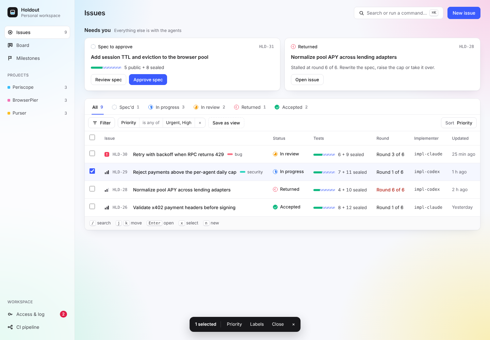
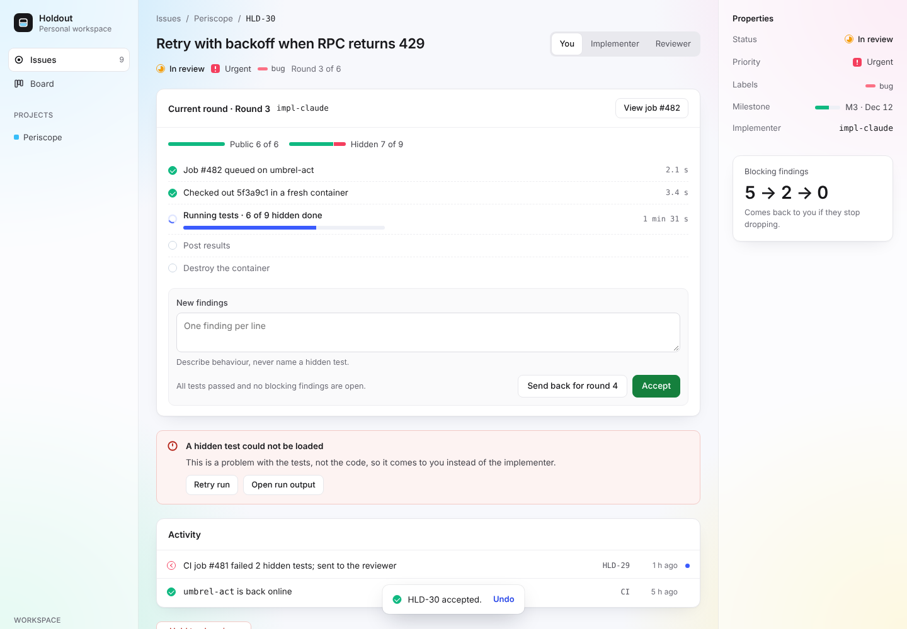

# Omakase

*The chef chooses.* An opinionated design system for web apps: light, joyous and quiet. The decisions are already made (one ultramarine accent, drawn status glyphs, ratio bars instead of pills, white cards on a canvas with four soft corner blooms, centred pop-ups), so a new app starts from a finished taste instead of a blank page.



**Building with an AI agent?** Drop the skill into your project:

```bash
git clone --depth 1 https://github.com/Oni-giri/omakase-design /tmp/omakase && mkdir -p .claude/skills && cp -R /tmp/omakase/skill/omakase .claude/skills/
```

The agent then installs the system on its first UI task (`skill/omakase/install.sh`), wires it for the project's stack, reads [`AGENTS.md`](AGENTS.md) and runs the style check before finishing. For agents without skills, point them at `AGENTS.md` directly.

## What's inside

| Path | What |
| --- | --- |
| `css/omakase.css` | The one file to include: fonts, tokens as CSS variables, every component (`om-` classes). Generated. |
| `css/components.css` | Component source CSS. |
| `tokens/tokens.json` | Source of truth: colours, type, spacing, radius, shadows, each with a usage note. |
| `tokens/tokens.css` | Tokens as CSS custom properties plus `.om-text-*` type classes. Generated. |
| `tokens/tailwind.preset.cjs`, `tokens/tailwind-v4.css` | Tailwind v3 preset and v4 theme mapping to the same tokens. Generated. |
| `react/` | Typed React 18+ components (no dependencies), meant to be copied into an app. |
| `examples/app.html` | A full list page in plain HTML. |
| `examples/react/DetailPage.tsx` | A detail page composed from the React components. |
| `icons/`, `logos/` | Stroke icons on a 16px grid; Holdout's logo as an example. |
| `docs/` | Principles, component catalogue, page patterns, screenshots. |
| `scripts/build.mjs` | Regenerates the generated files (`node scripts/build.mjs`, no dependencies). |
| `scripts/check.mjs` | Style check for an app's code: pills, grey fills, side sheets, hard-coded colours… |
| `skill/omakase/` | Drop-in agent skill: `SKILL.md` and `install.sh`. |

## Quick start

Plain HTML:

```html
<link rel="stylesheet" href="css/omakase.css">
<body class="om-app om-canvas">
  <span class="om-st om-st-review">In review</span>
  <span class="om-tline"><span class="om-ratio" style="width:90px"><span class="om-r-pass" style="width:78%"></span><span class="om-r-fail" style="width:22%"></span></span>Hidden 7 of 9</span>
</body>
```

React: copy `react/` into your app, then

```tsx
import './omakase/css/omakase.css';
import { AppRoot, Card, StatusGlyph, RatioBar, Button } from './omakase/react';

<AppRoot>
  <Card title="Current round">
    <StatusGlyph status="review">In review</StatusGlyph>
    <RatioBar segments={[{ value: 7, kind: 'pass' }, { value: 2, kind: 'fail' }]} label="Hidden 7 of 9" />
    <Button variant="primary">Accept</Button>
  </Card>
</AppRoot>
```

## Principles in one breath

Light canvas, colour at the corners, content on white. Drawn glyphs and ratio bars, never pills. One accent. Colour lives in small marks. Centred pop-ups, never side sheets. Glass only for chrome. Not grey. Plain, verb-first copy. Full version: [`docs/principles.md`](docs/principles.md).


